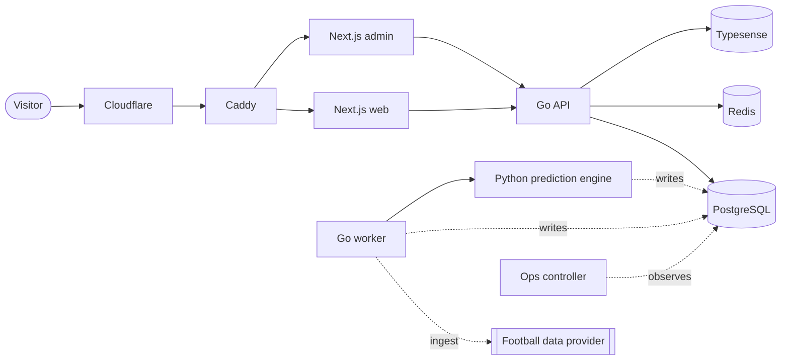

<p align="center">
  
</p>

<p align="center">
  Football match predictions, accumulators and live in-play probabilities,<br>
  in seven languages, from one server.
</p>

<p align="center">
  <a href="https://sokalens.com">sokalens.com</a> ·
  <a href="docs/ARCHITECTURE.md">Architecture paper</a> ·
  <a href="docs/architecture/decisions">Decision records</a>
</p>

---

SokaLens is a production prediction platform for football fans, built for
mobile users in African markets on slow networks. It ingests fixtures, odds and
live match data from a paid provider, runs a Python prediction engine behind a
Go worker, and serves a server-rendered Next.js site in seven locales. Every
published prediction is versioned, locked at kick-off and settled
automatically, so the public track record can always be recomputed from stored
rows.

It is a solo project, live since August 2026, and runs on a single VPS behind
Cloudflare.

## Highlights

- **Go modular monolith, PostgreSQL as the only source of truth.** Redis and
  Typesense hold disposable copies. No third-party call ever sits on a user's
  request path.
- **Quota as a budget.** The worker owns a hard daily ceiling on provider
  requests, fetches by date instead of by match, and spends what is left on
  history backfill. A worst-case day fits in about three quarters of the plan.
- **Auditable predictions.** A tiered market catalogue, a per-fixture quality
  gate, a challenger ensemble, point-in-time inputs, and settlement that is
  immediate, reversible and closes every market at full time.
- **Live in-play.** Server-sent events with a polling fallback under one
  entitlement-checked prefix, an append-only snapshot series kept apart from
  the settleable record, and VAR retractions that stay visible.
- **SEO enforced by code.** One function decides indexability for pages and
  sitemaps, and a CI gate fails any change that reintroduces a retired URL or
  ships a page without a canonical.
- **Safe delivery on one box.** Reviewed pull requests only, path-filtered CI
  with independent security scanners, QA-first releases, and a staged deploy
  that promotes the backend before the frontend and rolls back only what
  failed.
- **Operations that advise, not act.** An observe-only ops controller
  correlates alerts and asks an AI model for typed, bounded advice; an
  out-of-band Cloudflare Worker reports when the server itself is down.

## Architecture



Pages read state that background jobs already wrote, so a slow provider or a
failed model run makes data staler but never takes a page down. The full design,
with the reasoning behind each decision, is in the
[architecture paper](docs/ARCHITECTURE.md).

| Layer | Technology |
| --- | --- |
| API and worker | Go 1.27, `pgx/v5` |
| Prediction engine | Python 3, psycopg 3 |
| Web and admin | Next.js 16, React 19, TypeScript |
| Data | PostgreSQL 18, Redis 8, Typesense |
| Mobile (planned) | Flutter |
| Delivery | Docker Compose, Caddy, Cloudflare, GitHub Actions |
| Observability | Prometheus, Grafana, Loki, Sentry, Uptime Kuma |

## Repository layout

```text
apps/
  web/                 Public Next.js site (7 locales)
  admin/               Staff console
  mobile/              Reserved for the Flutter app
services/
  api/                 Go modular monolith: public, account and admin APIs
  worker/              Ingestion, scheduling, settlement, notifications
  prediction-engine/   Python inference, started by the worker
  model-lab/           Offline training and backtesting
  ops-controller/      Incident correlation, Telegram bot, AI advice
packages/
  contracts/           OpenAPI contract and shared URL rules
  ai-contract/         Typed, bounded AI advice contract
infra/
  db/migrations/       The single, additive migration stream
  docker/              Local Compose stack
  deploy/              Production overlay, Caddy, staged deploy script
  observability/       Prometheus, Grafana, Loki configuration
  sentinel/            Out-of-band health check (Cloudflare Worker)
tools/                 Release manifest, data correction tools
docs/                  Architecture paper, ADRs, contracts, runbooks
```

## Running it locally

Prerequisites: Docker, Go 1.27, Node.js 24, Python 3.13 and
[Task](https://taskfile.dev).

```bash
cp .env.example .env
docker compose -f infra/docker/docker-compose.yml --env-file .env --profile core up -d
task db:migrate
task db:seed
```

The `core` profile starts PostgreSQL, Redis, the API, the worker, the ops
controller and a mock football-data provider; real provider calls are off by
default. Add
`--profile frontend` for the web (`http://localhost:3000`) and admin
(`http://localhost:3001`) apps, `--profile search` for Typesense, or
`--profile all` for everything including the observability stack. The API
serves its reference docs at `http://localhost:8080/docs`.

Stop the stack with `task stack:down`.

## Tests and checks

```bash
task test    # every suite: Go, Python, web, admin, contracts
task lint
task build
```

CI runs the same Taskfile targets, only for the parts a change touches, plus
three gates that run on their own:

- `task security-invariants:test`: authentication, authorisation, entitlement
  and billing assertions, including the in-play stream.
- `task seo-invariants:test`: canonical URLs, sitemap rules and retired routes.
- Full-history secret scanning, `npm audit` and `govulncheck`, each in its own
  job so one scanner's outage cannot hide another's finding.

## Engineering practices

- **Every change is a pull request.** Nothing is pushed to `main` or `qa`
  directly; a code owner approves each merge, and the `CI gates` check must be
  green. Feature work lands in `qa` and is promoted to `main` once QA checks
  out.
- **Decisions are written down.** Architecture decision records live in
  [`docs/architecture/decisions`](docs/architecture/decisions), and the
  in-play wire format is a written contract
  ([`docs/integrations/in-play-data-contract.md`](docs/integrations/in-play-data-contract.md)).
- **Migrations are additive and checksummed.** An applied migration is never
  edited; the previous release must keep working against the new schema.
- **Tests must be able to fail.** Database-backed suites fail when the
  database is missing instead of skipping, and new guards are shown to fail
  without their fix before they are trusted.
- **Gates widen their timing, never their contract.** A failing validity check
  is a defect to fix, not a threshold to loosen.

Operational runbooks are in [`docs/operations`](docs/operations), starting
with [`environments.md`](docs/operations/environments.md).

## Contributing

Contributions are welcome. The public repository is a published snapshot of
a private one, so pull requests are applied upstream rather than merged on
GitHub; see
[CONTRIBUTING.md](CONTRIBUTING.md) for how that works.

## Licence

The source code is licensed under the GNU Affero General Public License
v3.0; see [LICENSE](LICENSE). The SokaLens name and logo are not licensed for
reuse. The offline training corpus is third-party match data and is not part
of the repository; see [`services/model-lab`](services/model-lab/README.md).
