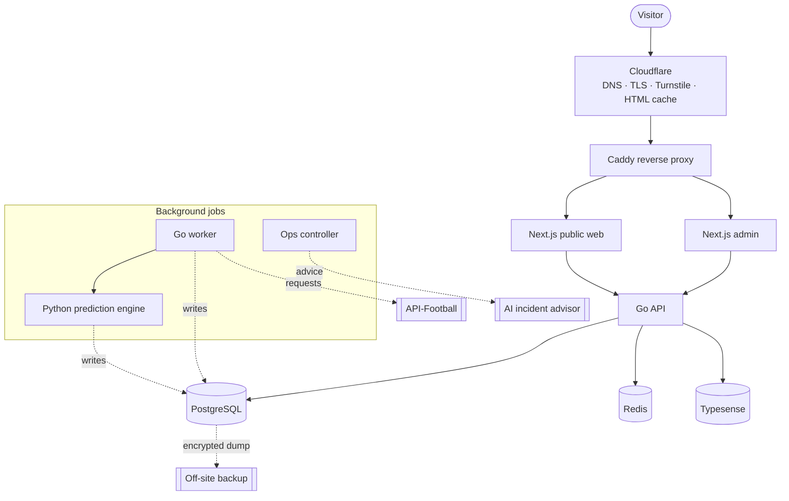

# SokaLens: Architecture of a Single-Server Football Prediction Platform

Shiundu Zachariah · October 2026

## 1. Abstract and scope

SokaLens publishes football match predictions, accumulators and live in-play
probabilities at [sokalens.com](https://sokalens.com) in seven languages. It
runs as a Go modular monolith with a Python inference engine started by
background workers, and PostgreSQL is its only source of truth. No external
dependency sits on a user's request path. Everything runs on one VPS behind
Cloudflare and Caddy.

Three goals drive almost every design decision: keep running costs near one
server, make change safe on a live system, and keep the published track record
honest and recomputable.

This paper describes the system as built in October 2026: the runtime
components, data rules, provider ingestion, the prediction pipeline, in-play,
the web front end, monetisation, infrastructure and delivery, observability,
security and quality gates. It ends with risks and the roadmap. Where a design
document and the code disagree, this paper follows the code.

**Not covered.** Model mathematics and feature engineering (see
[`docs/architecture/specifications`](architecture/specifications)), commercial
terms, and mobile screen design.

## 2. Context, drivers and constraints

SokaLens is a prediction media product, not a bookmaker: it publishes
analytical picks and never takes bets. Ad networks and app stores review it on
that basis, so the positioning shapes the architecture as much as any technical
requirement does.

| Driver | What it means for the architecture |
| --- | --- |
| Ad-funded, with a paid Pro tier | Running cost must stay near one server. Every component is weighed against the budget. |
| One developer working with AI coding agents | Rules live in the repository ([`AGENTS.md`](../AGENTS.md), ADRs) and in CI checks, not in anyone's memory. Every change is a reviewed pull request. |
| Priority markets: Kenya, Nigeria, Ghana, Uganda, South Africa, Tanzania | Mobile-first pages, server rendering, small client JavaScript, budgets set for slow 3G/4G. Most visits come from phones. |
| Seven locales (en, es, fr, pt, ar, de, it) | Locale-prefixed routes, one i18n pipeline, strict hreflang (ADR 0006). |
| A paid, rate-limited data provider | Provider calls never sit on a user request path. Quota is a budget with a hard daily ceiling (§7). |
| A live product with a public track record | Additive-only schema changes, versioned predictions, QA-first staged releases. |
| Search is the main acquisition channel | URL design, sitemaps, canonicals and page lifecycle are architectural concerns, not marketing ones. |

**Where it stands.** The site has been live since August 2026. In-play
predictions are live and public. Ads serve through a multi-network router. A
front-end redesign is in progress, and the Flutter app is a reserved folder
with no code yet.

## 3. Architectural principles

Eleven rules govern every change. Most exist because breaking them once would
cost data, trust or search ranking that cannot be bought back.

**Structural principles**

1. **PostgreSQL is the source of truth.** Redis holds cache, queues and locks
   only; anything it loses is rebuilt from PostgreSQL.
2. **Third parties stay off the request path.** Only the worker calls the data
   provider. Python runs when the worker starts it, never because a page was
   requested (ADR 0002). Pages read state that jobs already wrote.
3. **One migration stream, additive only.** Every schema change lives in
   `infra/db/migrations` and adds nullable columns or new tables. The live
   engine and the previous release must keep working against the new schema
   (ADR 0001).
4. **QA first, then staged promotion.** Every change runs on QA before
   production, and production promotes the backend before the frontend (§12).
5. **Edge features are adopted only when they pay.** Cloudflare does DNS, TLS
   and Turnstile. Beyond that it is used only where measurement justified it:
   HTML edge caching, inbound email routing and an out-of-band health check.
6. **Cost is a design input.** Each infrastructure choice is checked against a
   small monthly budget before it is checked against elegance.

**Integrity principles**

7. **Snapshot, never overwrite.** Odds, in-play probabilities and match
   statistics are stored as time-stamped rows, so any past view can be rebuilt.
8. **Published predictions are versioned and corrections stay visible.** A
   change creates a new version. A withdrawn goal is marked retracted, never
   deleted, and settlement can be reversed.
9. **Full time closes every market.** A market that cannot be graded closes as
   `unsettled_data_unavailable` and is left out of accuracy figures. Nothing
   stays pending.
10. **Policy is enforced on the server.** Tiers, restricted countries, legal
    rules and ad behaviour are decided by the API; clients only render the
    answer.
11. **No data-provider names in customer-facing UI**, markup or image URLs.

**Ways of working.** Safety comes from executable invariants, canaries,
reconciliation jobs and automatic rollback rather than from deploy-time sign-off
(ADR 0005). Every change arrives as a pull request that a code owner approves;
once it merges, release proceeds without a further manual gate. A person must
also decide on new credentials or paid resources, pricing, legal questions,
irreversible bulk actions and any widening of automation authority.

## 4. System overview

Three containers answer every user request from state in PostgreSQL.
Ingestion, modelling and incident analysis run behind that state, and they are
the only parts that call outside the server.

Requests flow through the solid edges. The dashed jobs write the state those
requests read, so a slow provider or a failed model run makes data staler but
never takes a page down. Three outbound dependencies carry architectural
weight: provider ingestion, AI incident advice and off-site backups. The
diagram leaves out the QA stack on the same host (§12), plus email (Resend),
error reporting (Sentry), the Telegram bot and the out-of-band sentinel (§13).

## 5. Component architecture

One monorepo holds ten deployable or runnable units. Two Go services do all the
online work; everything else renders pages, runs models, watches the system or
supports releases.

| Component | Path | Stack | Responsibility | On request path? |
| --- | --- | --- | --- | --- |
| API | `services/api` | Go 1.27, `pgx/v5` | Modular monolith: public reads, accounts, sessions, tiers and entitlements, billing admin, search, sitemaps, admin APIs. Serves its OpenAPI contract at `/openapi.yaml` and reference docs at `/docs`. | Yes |
| Worker | `services/worker` | Go 1.27 | Provider ingestion and quota planning, leased job queues, engine runs, settlement, accumulator recommendations, notifications, email. | No |
| Prediction engine | `services/prediction-engine` | Python 3, psycopg 3 | Inference for a given fixture scope and as-of time; writes versioned rows to `engine_predictions`. Started by the worker. | No |
| Model lab | `services/model-lab` | Python | Offline training and backtesting on a historical match corpus. | No |
| Public web | `apps/web` | Next.js 16.4, React 19.3, TypeScript 6.0 | Server-rendered public site in 7 locales, SEO metadata, structured data, ad slots. | Yes |
| Admin | `apps/admin` | Next.js 16.4 | Content, predictions, providers, users, ad routing, read-only ops views. | Staff only |
| Ops controller | `services/ops-controller`, `packages/ai-contract` | Go 1.27 | Observe-only incident detection, signed alert intake, Telegram bot and digests, AI-advised diagnosis (§13). | No |
| Sentinel | `infra/sentinel` | Cloudflare Worker | Out-of-band check of the public site and API health from outside the server. | No |
| Release manifest | `tools/release-manifest` | Go | Builds an immutable release record: Git SHA, image digests, migration version, last-known-good release. Built and tested in CI; not yet wired into the deploy. | No |
| Mobile | `apps/mobile` | Flutter (planned) | Folder reserved; no code yet. | — |

**Why a modular monolith.** One Go binary for the API keeps deployment,
transactions and tracing simple on one server. Internal module boundaries
(accounts, predictions, accumulators, in-play, billing, search) allow a later
split without a rewrite. The worker runs as a separate process, so ingestion
spikes and long jobs cannot starve request handling.

**Why Python sits behind the worker.** Modelling benefits from Python, but a
Python service on the request path would add a second runtime to scale and
monitor. ADR 0002 draws the line. Go owns scheduling, retries, concurrency
limits and publication. Python receives a fixture scope and an as-of timestamp,
reads only data available at that cutoff, and writes candidate rows. It never
calls the provider. The ADR calls this a temporary exception, kept so that the
runtime and the model never change at the same time.

**Mobile plan.** The Flutter app will reuse the same REST payloads, design
tokens and ad slot names as the web. Requirements: over-the-air updates, small
install size, partial offline mode, low data use on 2G/3G, strong
notifications, and a UI usable by people who read little. Ads will use AdMob
with mediation, because the web ad networks do not serve Flutter apps.

## 6. Data architecture

There are three stores and one truth: PostgreSQL owns every fact, while Redis
and Typesense hold copies that can be thrown away and rebuilt.

| Store | Role | Holds | If lost |
| --- | --- | --- | --- |
| PostgreSQL 18 | System of record (87 migrations, about 160 tables) | Fixtures, teams, leagues; odds, live and statistics snapshots; engine predictions and settlements; in-play series; users and entitlements; ad provider catalogue and outcomes; provider request ledger; ops incidents and budgets | Restore from the off-site backup |
| Redis 8 | Cache, queue, locks | Hot read caches, job queues, distributed locks, rate-limit counters | Nothing beyond a cold cache |
| Typesense 30.1 | Search index | Teams, leagues and fixtures | Rebuilt from PostgreSQL with `syncsearchindex`; search falls back to PostgreSQL meanwhile |

**Schema rules**

- **One canonical prediction store.** Engine output lives only in
  `engine_predictions` (ADR 0001). Rows are idempotent by content hash. A
  change supersedes a row instead of editing it, and each row carries
  point-in-time timestamps and model identity.
- **One id per thing.** Canonical `teams.id` and `fixtures.id` are used
  everywhere. Provider ids resolve through `provider_entity_maps`, and an
  unmapped entity is skipped, never guessed. Guessing once split a team's
  history across two ids, so the engine saw 6 matches instead of 15.
- **Snapshots in partitioned tables.** `fixture_live_snapshots`,
  `fixture_events`, `inplay_snapshots` and `fixture_statistics_snapshots` are
  time-partitioned. The worker creates partitions ahead of time, so inserts
  never fail for lack of one.
- **Additive changes only.** New columns are nullable and new concepts get new
  tables. A reverted feature leaves its table in place rather than risk a
  destructive down-migration.

**Retention by purpose (ADR 0004).** Four classes have separate deletion rules:

| Class | Kept for | Rule |
| --- | --- | --- |
| Public result detail | Recent user-facing history and disputes | Short, configurable window |
| Accuracy aggregates | Public reporting and trends | Durable; no raw payloads or user activity |
| Model-evaluation facts | Calibration, backtests, drift and promotion evidence | Durable; deletion needs a governance audit |
| Raw provider data | Replay inputs, only where licensed | Per provider and field; licensing overrides convenience |

Raw prediction rows are drained in bounded batches behind a cursor. Deletion
makes space reusable but does not shrink files; shrinking needs an online
`pg_repack` tested on QA first, never `VACUUM FULL` on production.

**Migrations are proven, not trusted.** CI applies every migration, then seeds
and verifies the result against a PostgreSQL 18 service container.
`task architecture:migrations:verify` runs the engine and operations
migrations through an up/down/up cycle on a disposable database to prove they
are additive and reversible, and every applied migration is checksummed so it
cannot be edited after the fact.

## 7. Provider ingestion and the quota budget

Only the worker talks to the data provider. It spends against a hard ceiling of
7,500 requests a day that it counts itself; the provider's response headers can
lower that number but never raise it.

**Plan sizing.** API-Football is the primary source, on a plan of 7,500
requests a day and 300 a minute. The platform briefly ran on a 75,000-a-day
plan, used less than a fifth of it, and moved back to 7,500 in October 2026. A
measured day in mid-October projected to about 3,200 requests, 43% of the
package. football-data.org is wired as a secondary source, and TheSportsDB
supplies crests and squad metadata only.

**Ingestion path**

1. The scheduler plans jobs from the fixture calendar and the quota forecast,
   with fixed priorities (the live poll first, backfill last).
2. A rate-limited client calls the provider. Every request is logged with a
   *reason* (live, reconcile, prematch, backfill and so on) in
   `provider_request_logs`.
3. Responses are normalised to canonical entities through
   `provider_entity_maps` and deduplicated.
4. Writes go to PostgreSQL in a transaction. Odds and live state become new
   snapshot rows; fixtures and results are upserted by canonical id.
5. Downstream jobs are queued: engine runs for changed fixtures, settlement for
   finished ones, cache invalidation and IndexNow submission for new public
   URLs.

**Fetch by date, not by match.** Everything that grows with the fixture list
is fetched per date in bulk, one request per date. The live poll
(`fixtures?live=all`) is one request every 60 seconds, however many matches are
in play, and runs only inside a watch window derived from the calendar.

**Where the 7,500 goes, worst case**

| Line | Requests a day |
| --- | --- |
| Live poll, every 60 s in the watch window | up to 1,440 |
| Results reconcile, hourly, batched by id | about 371 (measured) |
| Today's fixtures every 5 min, tomorrow hourly, 9 more dates every 4 h | 366 |
| Provider predictions, reference sync, odds sweeps | up to 370 |
| Quota sync and country/league lists | 26 |
| Discretionary history backfill | up to 1,200 |
| Daily reserve plus emergency reserve (12%) | 1,800 |
| **Total** | **about 5,570** |

That leaves about 1,900 requests of headroom. The hourly reconcile is the
largest single line on a normal day, at about a quarter of spend, and the first
thing to cut if spend must fall.

**Four controls keep spend inside the package**

- **A ceiling the process owns.** The worker counts requests it has sent since
  00:00 UTC and refuses past the plan limit. That check runs before every
  escape hatch (probe allowances, recovery probes, decaying reserves). The
  count is seeded from the request log at startup, so a restart cannot reset
  it.
- **A daily cap on backfill.** Once, a restart left 4,076 backfill jobs queued;
  every per-cycle cap held, and the day still spent about 74,000 requests. The
  cap now counts jobs already queued today, and it fails closed if the database
  cannot answer.
- **Pacing against the plan, not the header.** Cadence clamps (live poll at
  least 60 s, in-play statistics at least 5 min) read the configured plan
  limit. A header claiming a larger plan cannot relax them.
- **Burn gauges with early warnings.** Spend is published per reason against
  the package. Warnings fire at 60% and errors at 80%, while there is still
  time to act.

**Unused quota is spent, not wasted.** The allowance expires at 00:00 UTC, so
a pacer gives the surplus to prediction-history backfill within the daily cap.

**Cold start.** At season start, prior-season statistics are the fallback for
every team, not only promoted ones, and the engine flags each prediction that
used it.

## 8. Prediction pipeline

Predictions are produced in batch, gated before publication, locked at kick-off
and settled automatically, so the public record can always be recomputed from
stored rows.

| Element | How it works |
| --- | --- |
| Tiered market catalogue | Tier A goal markets (match result, totals, both teams to score) are always attempted. Tier B (corners, cards) and Tier C (shots, possession) need per-league data coverage and pass stricter gates. Tier D combinations are derived from A and B, not modelled separately. |
| Match quality gate | Each fixture gets one of three outcomes. SKIP publishes nothing. BASIC publishes Tier A probabilities only, never as best bets. FULL runs every applicable tier, with confidence scores. |
| Ensemble with challengers | Model A, a scoreline-probability model, carries the whole blend today. Models B (a capped form adjustment) and C are registered at zero weight and gain weight only by beating A as challengers. |
| Staged lifecycle | EARLY (days out) → PRE-MATCH (about 6 h) → LINEUP-CONFIRMED (when lineups arrive) → LOCKED at kick-off. Each re-run writes a complete new version, never a patch. |
| Point-in-time inputs | The worker passes an explicit as-of timestamp. The engine reads only data available by then, so backtests and replays match what was really knowable. |
| 7-day horizon | Fixtures up to 7 days ahead are predicted and refined as kick-off nears. |
| Interleaved-match embargo | If a team plays again before a predicted fixture, that fixture is withheld until the earlier result is in, then re-triggered automatically. |
| Bounded concurrency, time-window slicing | Every eligible fixture is predicted. Jobs are leased and sliced by kick-off window so near fixtures go first, and fixed worker pools protect the database. |
| Accumulator engine | Builds the system accumulators and powers the user Builder. One pick per match on any slip, because outcomes in the same match are linked. |

**Settlement and the track record.** The worker settles each market once its
outcome is certain, as won, lost or void. Full time closes every market, and
one that cannot be graded closes as `unsettled_data_unavailable`, outside
accuracy figures. The public hit rate is won ÷ (won + lost); voids are listed
but excluded.

**Known weakness.** The site reports one blended accuracy figure across markets
with very different base rates, which is hard to interpret. The planned fix is
a per-market edge analysis against bookmaker implied probability, exposed
through an additive per-market field in the API.

## 9. In-play architecture

In-play adds a live prediction stream beside the pre-match one without
weakening the rule that published pre-match picks never change. It is live in
production and public: since 6 October 2026 anonymous visitors can read it
without signing in (ADR 0007). The binding wire format is
[`docs/integrations/in-play-data-contract.md`](integrations/in-play-data-contract.md).

**Two record types, kept apart on purpose**

|  | `engine_predictions` | `inplay_snapshots` |
| --- | --- | --- |
| Purpose | The auditable, settleable published prediction | The time series a chart draws |
| Grain | One row per market per publication | One row per fixture per tick, markets in JSONB |
| Lifecycle | Superseded, settled, reversible | Append-only, never settled |
| Volume | Grows only when content changes | About 24,000 rows on a busy Saturday |

One table would not work. Storing each market as its own row every tick would
be about 1.8 million rows on a Saturday, which makes the chart unaffordable.
Folding settlement into the series would make it impossible to audit.

**When a snapshot is written.** Every 60 seconds of play, plus just before and
just after each goal, red card and VAR decision, at each period change, and at
full time. The "before" snapshot is usually a link to the newest timer row, not
a new one. The full-time snapshot is kept forever; the others live in monthly
partitions, so retention is a partition drop rather than a bulk delete.

**Model health.** Every snapshot carries `ok`, `stale` or `suspended`. Stale
data is suppressed, never extrapolated: a stale figure is shown as "last
known", and a suspended one shows no probability. Extra time is not modelled.

**Markets that follow the match.** Goal lines are generated from the live
score: a nine-goal match is offered over 9.5 and settles over 0.5 to over 8.5
as won. Counting markets use a Gamma-Poisson rate update that blends the
pre-match expectation with the match's observed rate. Card markets publish
today; corners, shots and fouls depend on a batched statistics poll that is off
by default and switched on per environment against the quota budget.

**Settlement.** Settlement is immediate and reversible, with no time limit. A
goal withdrawn by VAR is marked retracted, never deleted; affected markets are
re-settled and the accuracy rollup recounts them. Each market's wire state is
`won`, `lost`, `void` or `unsettled_data_unavailable`, and the key is absent
until the market is graded.

**Transport.** Everything sits under one prefix, `/v1/inplay/`, served by one
handler, so any new route passes the same read policy or returns 404.

| Route | Purpose |
| --- | --- |
| `GET /v1/inplay/overview` | Cold first load in one call: board, series, timeline, cursor |
| `GET /v1/inplay/stream` | Server-sent events; each frame's id is the resume cursor (`Last-Event-ID`) |
| `GET /v1/inplay/changes?since=N` | Polling fallback every 15 s, using the same query as the stream |
| `GET /v1/inplay/fixtures`, `/fixtures/{id}` | Point-in-time board and single fixture |

The sequence number is the only resume token, because timestamps are not
totally ordered across a restart. Streams close after 30 minutes with an
explicit reconnect event, so a deliberate close is distinguishable from a
dropped network. Responses are `private, no-store` and `noindex`, so they never
cache at the edge or appear in search.

**Pre-match picks keep their own state.** A pick locked at kick-off is tracked,
never re-priced. Its `tracker_state` (`on_track`, `off_track`, `won`, `lost`,
`void` or `unknown`) is computed on the server, so every client agrees.

**Capacity.** Server-sent events hold one connection per viewer. On a single
server this is the first feature where concurrent viewers, not request rate,
set the limit. The 15-second polling fallback and the bounded stream lifetime
are the relief valves.

## 10. Front-end architecture

The public site is server-rendered Next.js, cached at the edge for anonymous
visitors.

**Rendering.** List, team and league pages render on the server for
crawlability and a fast first paint on slow networks. Client JavaScript is kept
small; the live match view hydrates, then subscribes to the in-play stream.
Every navigation is a real `<a href>`, so crawlers can follow it.

**Edge HTML caching.** Next.js marks dynamic pages uncacheable, so every
visitor, even one already at a nearby edge, paid a full round trip to the
server (TTFB 0.6–1.0 s). Caddy now sends `s-maxage=300,
stale-while-revalidate=60` for pages whose render is the same for every
anonymous visitor, and `s-maxage=15, stale-while-revalidate=30` for pages that
carry live scores. A Cloudflare cache rule makes that HTML eligible, and the
stale windows are short on purpose so a corrected prediction is never served
for long. `max-age=0` keeps browsers revalidating. After each deploy, CI purges
the cached HTML.

**Components.** Shared components such as `PredictionRow`, `TeamCrest` and
`AdSlot` render every list and slot. Team crests come only from an allowlist of
image hosts, served through the site's own image path, so no provider host
appears in markup; a hashed-colour initials shield is the fallback.

**Themes and locales.** Colours are CSS custom properties switched by
`data-theme`. Light and dark differ in token values only, never structure, and
an inline `<head>` script applies the stored theme before first paint. Seven
locales use prefixed paths, except English, which lives at the root
(ADR 0006). Odds format (decimal, fractional, American) is a saved user
preference.

**SEO is enforced by code.** In September 2026, Google had crawled about
16,930 URLs and declined 8,318, and impressions fell from 928 a day to 6. The
causes were structural: duplicate trees, two fixture URLs per match, and a
sitemap that disagreed with the pages. The fixes are structural too:

- **One canonical URL per thing.** `/en/*` redirects to the root, and
  `/matches/{id}` is retired in favour of `/predictions/{league}/{slug}-{id}`.
- **One function decides indexability.** Pages and sitemaps derive it from the
  same code. A fixture is indexable from when its prediction publishes until 14
  days after kick-off, then archived (`noindex, follow`, still served).
  Postponed or cancelled fixtures are never indexed.
- **A static invariant gate** (`task seo-invariants:test`) fails any PR that
  adds an `/en/` link, links to a retired URL, or ships an indexable page
  without a canonical. It also fails a sitemap that bypasses the shared
  builder, an image outside the guarded source, or an unlocalised kick-off
  time.
- **Scale.** The catalogue holds about 51,000 matches, 13,800 teams and 1,200
  leagues, so indexability must be derived continuously, never maintained as a
  list.

**Performance budget.** CLS under 0.1 with ads, mobile LCP within 2.5 s on
throttled 4G, no horizontal scroll at 320 px.

## 11. Monetisation architecture

Revenue comes from ads and a paid tier. Both are built so the business can
change ad network, weighting or price without a code change, and an ad that
fails to load leaves nothing behind.

**Tiers and entitlements.** Users are Anonymous, Basic (free account) or Pro,
with prices set in admin. Best Bets requires Basic or above; Pro removes ads.
The server decides access and sends locked content as
`{ locked: true, preview }`; the client never filters content itself. In-play
predictions are public by decision (ADR 0007), so they sit outside the tiers.
Billing sits behind a provider interface. Webhooks are signed and idempotent,
and a reconciliation job keeps checking that entitlements still match the
provider (ADR 0005).

**Multi-network ad routing.** Networks live in an `ad_providers` table that
admin edits, so no network is hard-coded. Each new browser session is assigned
a preferred network by traffic weight and remembered for 24 hours in Redis.
Each placement then tries, in order: the active network, the original
preference once its retry window passes, then every other healthy network by
priority. If all of them fail, the slot renders nothing.

**Safety rails.** New network rows ship disabled, so applying the migration
cannot start a third-party script. Public configuration holds browser-safe ids
only, never secrets, HTML or script URLs; adapters and their allowed origins
are reviewed in code, and a network without a reviewed adapter fails closed.
Every outcome is recorded with a signed, single-use, five-minute token
(`NO_FILL`, `TIMEOUT`, `BLOCKED`, `INVALID_ZONE` and others). Transport
failures open a per-network circuit breaker with a half-open probe.

**Five placements, named by position, not page.** One network unit can render
many times, so five units cover the site instead of 39:

| Placement | Where | When unfilled |
| --- | --- | --- |
| `page-top` | Banner under every page masthead | Reserved space collapses (the only layout shift allowed) |
| `feed-inline` | At intervals through every scrolling feed; tiles adapt to the column width | Stays zero height |
| `page-rail` | Desktop side rail | Stays hidden |
| `mobile-adhesion` | Fixed mobile band above the tab bar; never on the Builder | Not rendered |
| `global-footer` | Every page, above the footer | Collapses |

Ads never sit inside or over a score, a pick, a Builder ticket or the tab bar.

**Compliance surfaces.** The 18+ and "not a bookmaker" treatment appears on
every page type, and ad-network review depends on it. Sharing works without
login (device share, WhatsApp, Telegram, X and others) through a bounded,
rate-limited endpoint that records first-touch attribution.

## 12. Infrastructure, deployment and CI/CD

Production and QA share one VPS, kept apart by separate Docker daemons, ports
and credentials. Code reaches production only through reviewed pull requests
and CI: QA first, then a staged backend-before-frontend promotion.

**Hosting.** Production runs on a single 8 vCPU / 24 GB VPS. It moved there in
September 2026 from a smaller 4 vCPU / 6 GB host because the new one is cheaper
and has four times the memory, which is what lets QA and the observability
stack share it.

**Runtime topology**

| Layer | Choice | Notes |
| --- | --- | --- |
| Edge | Cloudflare | DNS, TLS, Turnstile bot checks, static and anonymous-HTML caching, inbound email routing |
| Reverse proxy | Caddy, on the host | TLS at the origin, routing, per-route cache headers |
| Compute | Docker Compose | 17 production containers: core services, frontends, search, observability and a mock provider |
| Network exposure | Firewall open only to HTTP, HTTPS and SSH | Key-only SSH with intrusion banning; databases and services bind to loopback only |
| Backups | Encrypted PostgreSQL dump taken before any deploy that applies a migration, uploaded to an S3-compatible bucket outside Cloudflare | A recovery point exists before every schema change, and backups do not share the edge's failure domain |
| Email | Resend outbound with an ordered fallback chain; Cloudflare Email Routing inbound | Verification and password-reset mail |

**Two environments, exactly**

|  | Production | QA |
| --- | --- | --- |
| Docker daemon | Rootful | Rootless, under its own user |
| Database | Its own | Its own, with separate credentials |
| Provider calls | Live | Off; mock provider |
| Deployed by | CI `deploy` job on green `main` | `qa-deploy.yml` on every merge to `qa` |

The two are isolated three ways: QA's rootless daemon cannot see production
containers, volumes or images; host ports are disjoint and bound to loopback;
and the databases have separate names and credentials. A third environment is
forbidden by policy, because idle extra environments were once found holding
disk and memory on this host.

**Change control.** Nobody pushes to `main` or `qa`. A repository ruleset
requires a pull request, an approving review from a code owner, and a green
`CI gates` check, and it forbids force-pushes and branch deletion. Feature
work merges into `qa`; a `qa` → `main` pull request promotes it.

**CI.** `.github/workflows/ci.yml` detects which paths changed and runs only
the affected jobs: api, worker, web, admin, mobile, contracts, ops tooling,
infra docs, security invariants and SEO invariants. `npm audit`, `govulncheck`
and a full-history gitleaks secret scan each run as their own job, so an outage
in one cannot hide a finding in another. Build, test and lint steps call
Taskfile targets, so local and CI runs use the same commands. A single
`CI gates` job summarises the path-filtered jobs into the one required check.

**Staged production deploy.** On green `main`, `infra/deploy/ci-deploy.sh`:

1. builds every image first, so a build failure changes nothing;
2. takes an encrypted database dump if a migration is pending, then migrates;
3. activates the backend and waits for it to report healthy;
4. runs the accumulator readiness gate, which checks duplicates, invalid rows,
   minimum coverage and non-empty API responses;
5. activates the frontend and waits for health again;
6. if the frontend fails, rolls back the frontend only and keeps the validated
   backend;
7. records separate backend and frontend release SHAs on the host; CI then
   purges cached HTML at the edge and verifies the live pages and sitemaps.

Gates may widen their timing but never their validity checks; loosening a
validity check to get a deploy through is forbidden.

**Runners.** CI and deploy jobs run on a self-hosted runner, which keeps the
project inside GitHub's free Actions allowance; on hosted runners the same
volume would need several thousand minutes a month. Pull requests from forks
are routed to GitHub-hosted runners so outside code never executes on the
production host. Every job has a timeout, and the frequent scheduled jobs never
fall back to hosted runners. The workflows reach the server through one
composite action that reads the address, port, user, key and a pinned host key
from repository secrets.

**Scaling path.** One server is a cost decision, not a ceiling. The first
pressures will be in-play stream connections (§9) and PostgreSQL memory.
Because the API is stateless and all state is in PostgreSQL, the next steps are
a separate database host, then more API replicas behind Caddy.

## 13. Observability and operations automation

Telemetry flows into one ops controller that deduplicates, correlates and
reports it. The controller runs in observe-only mode, AI may advise but never
act, and a separate sentinel outside the server reports when the site itself is
down.

**Telemetry stack.** Prometheus, node-exporter and cAdvisor for metrics. Loki
and Promtail for logs. Grafana for dashboards, Uptime Kuma for probes, and
Sentry for application errors. The worker publishes quota burn (§7), queue
depth and ingestion health; the admin app has read-only ops views.

**The ops controller** (`services/ops-controller`)

- **Signed alert intake.** Alerts arrive authenticated with a shared signing
  secret and protected against replay. Intake is disabled when no secret is
  configured, the controller refuses to start with one shorter than 32
  characters, and an accepted alert is never acknowledged and then dropped.
- **Incidents.** Alerts are classified, correlated within a 15-minute window
  and stored as incidents. The controller itself evaluates target
  availability, disk and memory headroom, backfill queue size and provider
  reserve pressure.
- **Telegram.** One bot posts daily digests and incident warnings, with email
  as a fallback. It answers allow-listed users' read commands (`/status`,
  `/incidents`, `/queues`, `/deploys`, `/budget`, `/help`). A small set of
  typed runbooks (retry a job, check the backup, restart a service) needs an
  explicit `/confirm` and is disabled unless a flag turns it on. Grafana never
  posts to Telegram directly, because bypassing the controller would lose
  deduplication, correlation and severity, and turn one incident into many
  messages.
- **AI advice** (`packages/ai-contract`). Bounded, pre-redacted evidence goes
  in, and one of four typed recommendations comes out: observe more, recommend
  rollback, recommend restart, escalate to a human. The contract has no shell,
  SQL or deploy capability. The model adapter accepts only one fixed HTTPS
  endpoint and enforces size caps, timeouts, bounded retries, a circuit breaker
  and schema-validated output. Durable per-incident budgets for tokens, cost,
  attempts and parallelism stop retries from overspending, and two controllers
  cannot double-spend.

**Autonomy is a ladder, and it is on the bottom rung (ADR 0003)**

| Mode | May do | May never do |
| --- | --- | --- |
| `observe` (current) | Ingest, correlate, record incidents and recommendations, notify | Any production or repository change |
| `assist` | Open an issue or proposed workflow that needs approval | Merge, deploy, roll back, restart, scale |
| `auto_rollback` | Roll back one recent, clearly correlated deployment to the recorded last-known-good | AI-chosen targets; schema rollback |
| `auto_heal` | Typed restart, lease recovery, bounded scaling, cache and backup checks | Arbitrary shell; destructive operations |
| `auto_patch` | Send an AI-written patch through PR, CI, QA, canary and promotion | Pushing directly or skipping any gate |

Any mode other than `observe` currently fails configuration validation, so
moving up a rung is a deliberate code change.

**The sentinel** (`infra/sentinel`). A Telegram sender inside the server cannot
report that the server is dead. A Cloudflare Worker checks the public site and
the API health endpoint every 5 minutes from outside and alerts after 3
consecutive failures, so in about 15 minutes. It has its own bot token, an
`OUT-OF-BAND` prefix and email as well as Telegram, and it deploys separately.
A broken deploy therefore cannot take down the thing that reports broken
deploys.

## 14. Security architecture

Security rests on server-side enforcement, secrets that never enter the
repository, reviewed changes, and a permanent invariant battery that every
change must pass.

**Controls by layer**

| Layer | Control |
| --- | --- |
| Edge | Cloudflare TLS. Turnstile gates registration and login, and fails closed when its own check errors. |
| Host | Firewall open only to HTTP, HTTPS and SSH; key-only SSH with intrusion banning; services bound to loopback |
| Client IP | Taken only from trusted edge headers, so spoofed headers cannot skew attribution or rate limits |
| Authentication | Passwords of 8–128 characters, a reset flow, per-identity rate limits with a bounded identity map, admin sessions capped at 8 hours |
| Authorisation | Tiers, admin roles, restricted countries and legal rules are all decided in the API |
| Secrets | Only `*.example` env files are committed, with placeholders. Production secrets live on the host; CI secrets, including every server connection detail, live in GitHub secrets. |
| Change control | Pull request, code-owner approval and green CI for every merge into `main` or `qa`; fork pull requests never run on the self-hosted runner |
| Data at rest | Backups are encrypted on the host before upload; dumps and test output are gitignored |
| Privacy | Double opt-in and one-click unsubscribe, in line with Kenya's Data Protection Act 2019 |
| AI | Advisory-only contract, pre-redacted evidence, one fixed endpoint, schema-validated output (§13) |

**The invariant battery.** `task security-invariants:test` runs
authentication, authorisation, entitlement and billing assertions on every PR
that touches the API. It also parses in-play stream frames, so the stream is
held to the same rules as every JSON route.

**Defects caught before merge.** Security review of each diff has caught and
closed, each with a regression test: a Turnstile check that failed open;
client-IP spoofing in attribution; an unbounded identity map in the auth rate
limiter, a denial-of-service risk; and a billing-admin permission that granted
too much. The Telegram integration review also found the evidence redactor
missing bare bot tokens, and fixed it before the bot went live.

**Scanners run independently.** `secret-scan` runs gitleaks over the full
history, with no default rules disabled and a reviewed allowlist of false
positives. `security-audit` (npm) and `security-audit-go` (`govulncheck`) run
as separate jobs. An unavailable audit is treated as a non-answer: it is
retried with backoff and fails closed, and is never bypassed.

## 15. Quality attributes and gates

Quality is enforced by numbers and by invariant jobs in CI, so a change cannot
ship a regression that only a careful human would have noticed.

| Attribute | Target or mechanism |
| --- | --- |
| Latency | Read-heavy public API p95 under 300–500 ms; match and prediction API p95 under 500 ms; auth p95 under 700 ms; 3 s hard ceiling on any request. Checked with k6 load tests (`task load:api:slo`). |
| Reliability | Normal-load error rate under 0.5%; client cancellations and deliberate load-shedding reported separately |
| Front end | CLS under 0.1 with ads; mobile LCP within 2.5 s on throttled 4G; no horizontal scroll at 320 px |
| Accessibility | 4.5:1 text and 3:1 UI contrast in both themes; `aria-current`, `aria-pressed` and labelled charts |
| Freshness (in-play) | Snapshot every 60 s of play; stale data suppressed, never extrapolated |
| Integrity | Pre-match picks locked at kick-off; every market closed at full time; hit rate = won ÷ (won + lost) |
| Honesty of copy | No guaranteed-outcome claims anywhere: web, mobile, API copy, notifications, ads or packaging |
| Security | `security-invariants` battery; independent secret, npm and Go vulnerability scans |
| Search | `seo-invariants` static gate on every PR, plus the deploy's own sitemap checks |
| Delivery | Promotion gates that may widen timing but never validity; canary decisions read auth shifts, webhook failures, entitlement mismatches, 5xx and p95/p99 latency |

**Tests must be able to fail.** Database-backed Go tests skip without a
database, so CI sets `WORKER_REQUIRE_DB_TESTS=1`, which makes a missing
database a failure instead of a silent skip. Several gated tests had skipped on
every CI run since they were written while the suite read green. New guards
are mutation-tested: the test is shown to fail with the fix removed before it
is trusted.

**Why invariants.** In September, most of the critical Search Console issues
that had been marked fixed showed validation as "Failed": fixes had regressed
or never fully landed. A named, failing assertion is the only reviewer that
runs on every PR without fail.

## 16. Risks and roadmap

The architecture is sound for its stage. The biggest risks are not in the code
paths: they are one host carrying everything, search treatment of a large
programmatic catalogue, and the credibility of the published record.

| Risk | Why it matters | Mitigation |
| --- | --- | --- |
| One host for production, QA and observability | A host failure takes everything down, and QA load shares production's CPU and memory | Rootless QA daemon, loopback-only ports, encrypted off-site backups, the out-of-band sentinel, a documented scaling path |
| Scaled-content classification by Google | Thousands of programmatic fixture pages fit the pattern search policy targets | Fixture lifecycle archiving, one indexability function, permanent team pages, page-specific computed numbers, no shared filler prose |
| One blended accuracy figure | It mixes markets with different base rates and undermines trust | Per-market edge analysis |
| In-play stream load at peak | Connections, not requests, become the limit | 15 s polling fallback, bounded stream lifetime |
| Gambling adjacency | Ad networks and app stores review this category closely | "Not a bookmaker" positioning and 18+ treatment on every page; analysis language only |
| Agent-assisted change at high speed | Many changes, little time per review | Mandatory reviewed PRs, invariant gates, QA-first staged deploys |

**Roadmap, in dependency order**

1. Ship the front-end redesign from QA to production.
2. Balance ad networks by measured fill and revenue.
3. Budget the in-play statistics poll, so corners, shots and fouls markets
   publish.
4. Per-market accuracy and the edge analysis.
5. Truthful sitemap `lastmod` from a real content-change time; head-to-head
   pages; richer team pages.
6. Move the ops controller from `observe` to `assist`.
7. The Flutter app (Android first) on the same APIs, tokens and slot names,
   with AdMob.
8. A separate database host, when stream connections or PostgreSQL memory
   require it.

## 17. Appendix: decision log and glossary

**Decision log** (newest first; ADRs are in
[`docs/architecture/decisions`](architecture/decisions))

| Date | Decision | Rationale |
| --- | --- | --- |
| Oct 2026 | Every change into `main` or `qa` is a reviewed pull request; fork PRs never reach the self-hosted runner | Human approval on every merge; outside code never runs on the production host |
| 16 Oct 2026 | Provider plan back to 7,500 requests a day; ceiling owned by the worker | Less than a fifth of the larger plan was used |
| 15 Oct 2026 | In-feed ads span the full column and adapt by width | A live review found squeezed widgets with split words |
| 6 Oct 2026 | In-play predictions are public, no login needed (ADR 0007) | Product decision; suppression, pacing and cache protections unchanged |
| 3 Oct 2026 | Staged production promotion: backend first, then frontend | One failure should never leave two fronts to debug |
| 3 Oct 2026 | Multi-network ad routing; unreviewed networks fail closed | No vendor lock-in; a script runs only after its adapter is reviewed |
| 22 Sep 2026 | QA deploys automatically on every merge to `qa` | A green branch check does not prove the deployed service works |
| 21 Sep 2026 | Daily backfill cap counted from queued jobs, failing closed | A restart left 4,076 jobs queued and the day spent about 74,000 requests |
| Sep 2026 | Production moved to a larger, cheaper VPS | Four times the memory, so QA and observability fit on the same host |
| Sep 2026 | Fixtures archive 14 days after kick-off as `noindex, follow`, never 404 or 301 | Mass redirects read as soft-404s; links must keep passing equity |
| 7 Sep 2026 | Retire duplicate URL trees; gate SEO rules in CI | Google declined 8,318 of about 16,930 URLs and impressions fell 99% |
| 5 Sep 2026 | Alerts reach Telegram only through the ops controller | Keeps deduplication, correlation and severity |
| 26 Aug 2026 | Locale-prefixed public routes, English at the root (ADR 0006) | Indexable content in 7 languages without duplicating entities |
| 14 Aug 2026 | `engine_predictions` is the one canonical prediction store (ADR 0001) | Two stores would split history, settlement and public reads |
| 14 Aug 2026 | Python inference runs behind the Go worker (ADR 0002) | Never change runtime and model in the same step |
| 14 Aug 2026 | Ops autonomy is a ladder, starting at observe-only (ADR 0003) | Controller failure must never widen the blast radius |
| 14 Aug 2026 | Four retention classes with separate deletion rules (ADR 0004) | Public, audit, model-evaluation and licensing needs differ |
| 14 Aug 2026 | Releases proceed by default, guarded by executable safety checks (ADR 0005) | Deploy-time sign-off does not scale and is not the real safety mechanism |
| Earlier | Off-site backups outside Cloudflare | Avoids sharing the edge's failure domain |
| Earlier | AdMob with mediation for the Flutter app | Web ad networks do not serve Flutter apps |
| Earlier | Prior-season statistics as the universal cold-start fallback | Predictions stay available at season start |

**Glossary**

| Term | Meaning |
| --- | --- |
| ACCA | Accumulator: several picks combined into one slip with multiplied odds |
| ADR | Architecture decision record |
| BTTS | Both teams to score |
| 1X2 / Match Result | Home win, draw or away win |
| Gate (SKIP, BASIC, FULL) | The per-fixture decision on how much to publish |
| Void | A settled market with no win or loss, such as a drawn draw-no-bet |
| `unsettled_data_unavailable` | A market closed at full time because the data to grade it never arrived; excluded from accuracy |
| Snapshot | An immutable, time-stamped record of odds, live state or model output |
| Sequence | Per-match counter that orders and resumes in-play data |
| Embargo | Holding a fixture's prediction until an earlier match involving one of its teams has finished |
| Sentinel | The out-of-band Cloudflare Worker that reports when the site is down |
| hreflang | Markup telling search engines which URL serves which language |
| CLS / LCP | Core Web Vitals: layout shift and largest contentful paint |
| SSE | Server-sent events: one-way streaming from server to browser |
