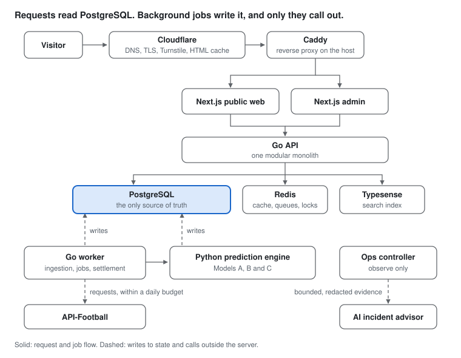

# SokaLens: Design and Engineering of a Football Prediction Platform

Shiundu Zachariah

## Abstract

SokaLens publishes football predictions, accumulators and live in-play
probabilities at [sokalens.com](https://sokalens.com) in seven languages. It
covers tens of thousands of matches across more than a thousand competitions,
and it runs on a single server.

This paper explains what was built and why. The platform is a Go modular
monolith with a Python inference engine behind it, and PostgreSQL is its only
source of truth. A worker process does everything that touches the outside
world: it buys data from a rate-limited provider, runs three competing
prediction models, grades every prediction once the match ends and keeps a
public track record that can be recomputed from stored rows. The web front end
is server-rendered Next.js behind Cloudflare and Caddy.

Three goals shape nearly every decision:

1. **Cost.** Running costs stay close to one server.
2. **Safe change.** A live system with a public record can change quickly
   without breaking that record.
3. **Honesty.** Every published number can be traced back to the data and
   model that produced it.

The paper covers the context and principles, then the components, data,
ingestion, prediction models, in-play system, front end, accounts,
infrastructure, operations, security and quality gates. It closes with the
known risks and the work still to do. Where a design document and the code
disagree, this paper follows the code.

**Not covered:** commercial terms and mobile screen design. The full model
specification is in
[`docs/architecture/specifications`](https://github.com/ShiunduZachariah/sokalens/tree/main/docs/architecture/specifications),
and the decision records are in
[`docs/architecture/decisions`](https://github.com/ShiunduZachariah/sokalens/tree/main/docs/architecture/decisions).

## 1. The problem and its constraints

SokaLens is a prediction media product, not a bookmaker: it publishes analysis
and never takes bets. Search engines, app stores and payment providers review
it on that basis, so this positioning shapes the architecture as much as any
technical requirement.

| Constraint | What it means for the architecture |
| --- | --- |
| Self-funded, with a paid Pro tier | Running cost has to stay near one server, and every component is weighed against that budget. |
| One developer working with AI coding agents | Rules have to live in the repository ([`AGENTS.md`](https://github.com/ShiunduZachariah/sokalens/blob/main/AGENTS.md), decision records) and in CI checks, not in anyone's memory. Every change is a pull request. |
| Most readers are in Kenya, Nigeria, Ghana, Uganda, South Africa and Tanzania | Most visits come from phones on slow 3G/4G, so pages are server-rendered, client JavaScript is small, and budgets are set for poor networks. |
| Seven locales (en, es, fr, pt, ar, de, it) | Locale-prefixed routes, one translation pipeline and strict hreflang (ADR 0006). |
| A paid, rate-limited data provider | Provider calls never sit on a user's request, and quota is a budget with a hard daily ceiling (§6). |
| A live product with a public track record | Additive schema changes, versioned predictions and QA before every release. |
| Search is the main source of visitors | URL design, sitemaps, canonical tags and page lifecycle are engineering concerns, not marketing ones. |

## 2. Principles

Eleven rules govern every change. Most exist because breaking one would cost
data, trust or search ranking that cannot be bought back.

**Structure**

1. **PostgreSQL is the source of truth.** Redis holds cache, queues and locks
   only, and anything it loses is rebuilt from PostgreSQL. A second source of
   truth would eventually disagree with the first, and the public record would
   be wrong in a way nobody could prove.
2. **Third parties stay off the request path.** Only the worker calls the data
   provider, and Python runs when the worker starts it, never because a page
   was requested (ADR 0002). Pages read state that jobs have already written, so
   a slow provider makes data staler but never takes a page down.
3. **One migration stream, additive by default.** Every schema change lives in
   `infra/db/migrations`, normally as new nullable columns or new tables. The
   running release and the previous one must both keep working against the new
   schema (ADR 0001), which is what makes a rollback safe. A migration that
   changes existing data takes a verified recovery point first.
4. **QA first, then a staged promotion.** Every change runs on QA before
   production, and production promotes the backend before the frontend (§11).
5. **Edge features only when they pay.** Cloudflare does DNS, TLS and bot
   checks. Anything beyond that, such as HTML caching, email routing or an
   outside health check, was adopted only after measurement justified it.
6. **Cost is a design input.** Each infrastructure choice is checked against a
   small monthly budget before it is checked against elegance.

**Integrity**

7. **Snapshot, never overwrite.** Odds, in-play probabilities and match
   statistics are stored as time-stamped rows, so any past view can be rebuilt
   exactly as it was.
8. **Published predictions are versioned, and corrections stay visible.** A
   change creates a new version. A withdrawn goal is marked retracted, never
   deleted, and settlement can be reversed.
9. **Full time closes every market.** A market that cannot be graded closes as
   `unsettled_data_unavailable` and is left out of accuracy figures. Nothing
   stays pending forever.
10. **Policy is enforced on the server.** Tiers, restricted countries and legal
    rules are decided by the API, and clients only render the answer. A rule
    enforced in the browser is a suggestion.
11. **No data-provider names in anything a customer sees**, including markup
    and image URLs.

**How change happens.** Safety comes from executable checks, reconciliation
jobs and automatic rollback rather than from sign-off at deploy time
(ADR 0005). Every change arrives as a pull request that the owner decides on;
once it merges, release proceeds without a further manual gate. A person still
has to decide on new credentials or paid resources, pricing, legal questions,
irreversible bulk actions and any widening of what automation may do.

## 3. System overview

Three containers answer every user request, and they answer it from state in
PostgreSQL. Ingestion, modelling and incident analysis run behind that state,
and they are the only parts that call outside the server.

Solid edges carry requests. Dashed edges are jobs writing the state those
requests read. This split is the central idea of the design: the request path
depends only on the local database, so a provider outage or a failed model run
degrades freshness rather than availability.

The diagram leaves out backups and the QA stack on the same host (§11), and
email, error reporting, the Telegram bot and the outside health check (§12).

## 4. Components

One monorepo holds ten deployable or runnable units. Two Go services do all
the online work; everything else renders pages, runs models, watches the
system or supports releases.

| Component | Path | Stack | Responsibility | On the request path? |
| --- | --- | --- | --- | --- |
| API | `services/api` | Go 1.27, `pgx/v5` | Modular monolith: public reads, accounts, sessions, tiers and entitlements, billing admin, search, sitemaps and admin APIs. Serves its OpenAPI contract at `/openapi.yaml` and reference docs at `/docs`. | Yes |
| Worker | `services/worker` | Go 1.27 | Provider ingestion and quota planning, leased job queues, engine runs, settlement, accumulators, notifications and email. | No |
| Prediction engine | `services/prediction-engine` | Python 3, psycopg 3 | Inference for a fixture scope at an as-of time, with Models A, B and C (§7). Writes versioned rows to `engine_predictions`. Started by the worker. | No |
| Model lab | `services/model-lab` | Python | Offline training and backtesting on a historical match corpus. | No |
| Public web | `apps/web` | Next.js 16, React 19, TypeScript | Server-rendered public site in seven locales, SEO metadata and structured data. | Yes |
| Admin | `apps/admin` | Next.js 16 | Content, predictions, providers, users and read-only operations views. | Staff only |
| Ops controller | `services/ops-controller`, `packages/ai-contract` | Go 1.27 | Observe-only incident detection, signed alert intake, Telegram bot and digests, AI-advised diagnosis (§12). | No |
| Sentinel | `infra/sentinel` | Cloudflare Worker | Checks the public site and API health from outside the server. | No |
| Release manifest | `tools/release-manifest` | Go | Builds an immutable release record: Git SHA, image digests, migration version and last-known-good release. Built and tested in CI, not yet wired into the deploy. | No |
| Mobile | `apps/mobile` | Flutter | Planned; the folder is reserved. | — |

**Why a modular monolith.** On one server, a single Go binary for the API keeps
deployment, transactions and tracing simple: one process to start, one
connection pool, and no network hop between modules. Internal boundaries
(accounts, predictions, accumulators, in-play, billing, search) are kept clean
so the API could be split later without a rewrite. The worker is a separate
process because its workload is spiky and long-running, and ingestion bursts
must not starve request handling.

**Why Go.** Go gives predictable latency and memory on a small machine, a
single static binary per service, and first-class concurrency for the worker's
bounded pools and leased queues. Its standard library covers HTTP, JSON and
cryptography, which keeps the dependency surface small.

**Why Python sits behind the worker.** Modelling benefits from Python, but a
Python service on the request path would add a second runtime to scale, secure
and monitor. ADR 0002 draws the line. Go owns scheduling, retries, concurrency
limits and publication. Python receives a fixture scope and an as-of timestamp,
reads only data available at that cutoff, and writes candidate rows. It never
calls the provider. The decision record calls this a deliberate exception, kept
so that the runtime and the model never change in the same step.

**Mobile plan.** The Flutter app will reuse the web's REST payloads and design
tokens. Its requirements follow the audience: over-the-air updates, a small
install, a partial offline mode, low data use on 2G/3G, dependable
notifications and an interface usable by people who read little.

## 5. Data architecture

There are three stores and one truth. PostgreSQL owns every fact; Redis and
Typesense hold copies that can be thrown away and rebuilt.

| Store | Role | Holds | If lost |
| --- | --- | --- | --- |
| PostgreSQL 18 | System of record (about 90 migrations, about 160 tables) | Fixtures, teams and leagues; odds, live-state and statistics snapshots; engine predictions and settlements; in-play series; users and entitlements; the provider request ledger; incidents and budgets | Restore from the newest verified recovery point (§11) |
| Redis 8 | Cache, queues, locks | Hot read caches, job queues, distributed locks, rate-limit counters | Nothing beyond a cold cache |
| Typesense | Search index | Teams, leagues and fixtures | Rebuilt from PostgreSQL with `syncsearchindex`; search falls back to PostgreSQL meanwhile |

**Why PostgreSQL alone.** A single relational store gives transactions across
everything a prediction touches: the fixture, the odds it saw, the model that
made it, and its settlement. Partitioning, JSONB and good indexing cover the
time-series and document needs that might otherwise justify extra databases,
and each database avoided is one less thing to back up, secure and keep
consistent on a single host.

**Schema rules**

- **One canonical prediction store.** Engine output lives only in
  `engine_predictions` (ADR 0001). Rows are idempotent by content hash, so a
  re-run that produces the same answer writes nothing new. A change supersedes
  a row instead of editing it, and every row carries point-in-time timestamps
  and model identity. Two stores would split history, settlement and public
  reads.
- **One id per thing.** Canonical `teams.id` and `fixtures.id` are used
  everywhere. Provider ids are resolved through `provider_entity_maps`, and an
  unmapped entity is skipped rather than guessed. A guess once split one team's
  history across two ids, and the engine saw six of its matches instead of
  fifteen.
- **Snapshots in partitioned tables.** `fixture_live_snapshots`,
  `fixture_events`, `inplay_snapshots` and `fixture_statistics_snapshots` are
  partitioned by time. The worker creates partitions ahead of need, so an
  insert never fails for lack of one, and retention becomes dropping a
  partition rather than deleting millions of rows.
- **Additive by default.** New columns are nullable and new concepts get new
  tables. A reverted feature leaves its table in place rather than risk a
  destructive down-migration.

**Retention by purpose (ADR 0004).** Data is kept according to why it exists,
not how old it is:

| Class | Kept for | Rule |
| --- | --- | --- |
| Public result detail | Recent user-facing history and disputes | Short, configurable window |
| Accuracy aggregates | Public reporting and trends | Durable; no raw payloads or user activity |
| Model-evaluation facts | Calibration, backtests, drift and promotion evidence | Durable; deletion needs a governance audit |
| Raw provider data | Replay inputs, only where licensed | Per provider and field; licensing overrides convenience |

Raw prediction rows are drained in bounded batches behind a cursor, so cleanup
never takes long locks. Deleting rows makes space reusable but does not shrink
files; shrinking uses an online `pg_repack` tested on QA first, never
`VACUUM FULL` on production.

**Migrations are proven, not trusted.** CI applies every migration, then seeds
and verifies the result against a PostgreSQL 18 service container.
`task architecture:migrations:verify` runs the engine and operations
migrations through an up/down/up cycle on a throwaway database to prove they
are additive and reversible, and every applied migration is checksummed so it
cannot be edited after the fact.

## 6. Provider ingestion and the quota budget

Every fact about football enters through one door. The worker buys it from a
paid provider, normalises it to canonical ids and writes it to PostgreSQL, and
it spends against a hard daily ceiling that it counts itself.

**Sources.** API-Football is the primary source, on a plan of 7,500 requests a
day and 300 a minute. football-data.org is wired as a secondary source, and
TheSportsDB supplies crests and squad metadata only. A much larger plan was
tried; it went mostly unused, which showed that the bottleneck was how
requests were spent, not how many were available.

**The ingestion path**

1. A scheduler plans jobs from the fixture calendar and the quota forecast,
   with fixed priorities: the live poll first, history backfill last.
2. A rate-limited client calls the provider. Every request is logged with a
   *reason* (live, reconcile, prematch, backfill and so on) in
   `provider_request_logs`, so spend can be attributed and audited.
3. Responses are normalised to canonical entities through
   `provider_entity_maps` and deduplicated.
4. Writes go to PostgreSQL in a transaction. Odds and live state become new
   snapshot rows; fixtures and results are upserted by canonical id.
5. Follow-on jobs are queued: engine runs for changed fixtures, settlement for
   finished ones, cache invalidation, and IndexNow submissions for new public
   URLs.

**Fetch by date, not by match.** Anything that grows with the fixture list is
fetched in bulk, one request per date. The live poll (`fixtures?live=all`) is
one request a minute however many matches are in play, and it runs only inside
a watch window derived from the calendar. A finished match simply drops out of
that live feed without ever being reported as finished, so the worker refetches
it by id rather than inferring the result.

**Where the daily budget goes, at worst**

| Line | Requests a day |
| --- | --- |
| Live poll, once a minute in the watch window | up to 1,440 |
| Results reconcile, hourly, batched by id | about 371 (measured) |
| Today's fixtures every 5 minutes, tomorrow hourly, nine more dates every 4 hours | 366 |
| Provider predictions, reference sync and odds sweeps | up to 370 |
| Quota sync and country/league lists | 26 |
| Discretionary history backfill | up to 1,200 |
| Daily and emergency reserves (12%) | 1,800 |
| **Total** | **about 5,570** |

That leaves about 1,900 requests of headroom, and a measured ordinary day uses
well under half the plan. The hourly reconcile is the largest single line on a
normal day and the first to cut if spend has to fall.

**Four controls keep spend inside the plan**

- **A ceiling the process owns.** The worker counts the requests it has sent
  since midnight UTC and refuses to send past the plan limit. That check runs
  before every exception (probe allowances, recovery probes, decaying
  reserves), and the count is seeded from the request log at startup, so a
  restart cannot reset it. The provider's response headers may lower the
  ceiling but never raise it.
- **A daily cap on backfill.** A restart once left 4,076 backfill jobs queued.
  Every per-cycle cap held, and the day still spent about 74,000 requests,
  because no cap counted the backlog as a whole. The cap now counts every job
  already queued that day, and it fails closed if the database cannot answer.
- **Pacing against the plan, not the header.** Cadence floors (live poll at
  least 60 s, in-play statistics at least 5 minutes) read the configured plan.
  A header claiming a bigger plan cannot relax them.
- **Burn gauges with early warnings.** Spend is published per reason against
  the plan. Warnings fire at 60% and errors at 80%, while there is still time
  to act.

**Unused quota is spent, not wasted.** The allowance resets at midnight UTC, so
a pacer gives the day's surplus to prediction-history backfill, within the
daily cap.

**A budget must never deadlock.** A refusal that never probes again can stall
ingestion forever. The budget keeps a small probe allowance and treats the
provider's status endpoint as the source of truth, so it recovers on its own
once quota is available.

**Cold start.** At the start of a season, prior-season statistics are the
fallback for every team, not only promoted ones, and each prediction that used
the fallback is flagged.

## 7. Prediction pipeline

Predictions are produced in batches, gated before publication, locked at
kick-off and settled automatically, so the public record can always be
recomputed from stored rows.

| Element | How it works |
| --- | --- |
| Tiered market catalogue | Tier A goal markets (match result, totals, both teams to score) are always attempted. Tier B (corners, cards) and Tier C (shots, possession) need per-league data coverage and pass stricter gates. Tier D combinations are derived from A and B rather than modelled separately. |
| Match quality gate | Each fixture gets one of three outcomes. SKIP publishes nothing. BASIC publishes Tier A probabilities only, never as best bets. FULL runs every applicable tier, with confidence scores. |
| A model per market | Each market publishes from the model or blend that won it on a historical holdout (below). |
| Staged lifecycle | EARLY (days out) → PRE-MATCH (about 6 hours out) → LINEUP-CONFIRMED (when lineups arrive) → LOCKED at kick-off. Each re-run writes a complete new version, never a patch. |
| Point-in-time inputs | The worker passes an explicit as-of timestamp, and the engine reads only data available by then. Backtests and replays therefore see exactly what was knowable, which is what makes them honest. |
| Seven-day horizon | Fixtures up to seven days ahead are predicted and refined as kick-off approaches. |
| Interleaved-match embargo | If a team plays again before a predicted fixture, that fixture is held back until the earlier result is in, then re-run automatically. |
| Bounded concurrency | Every eligible fixture is predicted. Jobs are leased and sliced by kick-off window, so nearer fixtures go first, and fixed worker pools protect the database. |
| Accumulator engine | Builds the site's accumulators and powers the user's Builder. A slip never takes two picks from one match, because outcomes in the same match are linked. |

**Settlement and the track record.** The worker settles each market as won,
lost or void as soon as its outcome is certain. Full time closes every market,
and one that cannot be graded closes as `unsettled_data_unavailable`, outside
the accuracy figures. The public hit rate is won ÷ (won + lost); voids are
listed but excluded. Because every prediction is stored with its inputs and
version, anyone with the data can recompute that figure.

### The three models

All three models forecast every fixture independently. Running them side by
side is what lets each market be decided by evidence rather than preference.

| Model | What it is | Forecasts |
| --- | --- | --- |
| A, the champion | A Poisson score grid. Team attack and defence ratings are fitted across the whole league over two seasons, with time decay and shrinkage toward the league mean. A capped form adjustment follows, and the match-result probabilities are pulled halfway toward the bookmaker line when real odds exist. | Every market |
| B, team strength | An Elo rating built from results alone. A Poisson regression maps the rating gap and the league's scoring rate to expected goals. | Goal markets |
| C, machine learning | LightGBM gradient-boosted trees with a Poisson objective for goals and counting statistics, and a negative binomial for counts because they vary more than a Poisson allows. Trees are exported to plain JSON, so serving needs only standard-library Python (ADR 0002). | Goal and count markets |

**Why these three.** They fail differently. The Poisson grid is interpretable
and stable, and the bookmaker anchor keeps its match-result line close to the
best public estimate. Elo needs only results, so it still works where detailed
statistics are thin. Gradient-boosted trees can use the richest statistics, and
they matter most for counting markets such as corners and shots, where rolling
averages are weak.

**How a market chooses its model.** Each market is scored on a holdout of
48,591 recent fixtures that none of the models saw in training, with settings
tuned on the season before. The score is log loss, where lower is better, and z
is a paired comparison against the champion on the same fixtures.

| Market | Published from | Champion | Published | z |
| --- | --- | --- | --- | --- |
| Match result (1X2) | Champion | 1.0089 | 1.0089 | |
| Double chance | Champion | 0.5889 | 0.5889 | |
| Over/under 2.5 goals | Blend of A, B and C | 0.6849 | 0.6803 | −10.1 |
| Both teams to score | Blend of A, B and C | 0.6903 | 0.6868 | −9.6 |
| Correct score | Blend of A, B and C | 2.9214 | 2.8984 | −26.4 |
| Half-time result | Model B | 1.0609 | 1.0503 | −11.3 |
| Total corners | Model C | 0.6729 | 0.6438 | −19.7 |
| Total shots | Model C | 0.5970 | 0.5453 | −25.5 |

The bookmaker anchor is why the champion keeps the match result: no model or
blend beats it there. The largest gains are on counting statistics, where the
champion's rolling averages scored worse than simply predicting the base rate
on five of seven markets. The market itself is still ahead: on over/under 2.5,
the closing line scores 0.6749 on fixtures with odds, against 0.6834 for
Model C on the same fixtures. The platform's honest claim is calibrated
analysis, not a systematic edge over bookmakers.

**How a chosen model publishes.** Models B and C store a forecast for each
fixture and lifecycle stage. At publication the pipeline reads the newest one
made by its as-of time, swaps in its probabilities and then picks the selection
as before. The gate and data requirements are unchanged, so this changes which
numbers are published, not which fixtures are covered. A missing or malformed
forecast falls back to the champion for that market alone, and every row
records which model produced it.

**Promotion before live evidence.** The governance rule asks for 500 settled
shadow forecasts before a model is promoted. Models B and C went live on the
holdout's evidence alone, by the owner's decision, and the model registry
records the exception. Calibration has not yet been fitted, so live results are
the open test of that decision, and a switch can return any market to the
champion.

**Known weaknesses.** The site reports one blended accuracy figure across
markets with very different base rates, which is hard to interpret; the planned
fix is a per-market edge analysis against bookmaker-implied probability.
Separately, the percentage shown on public pages is a composite confidence
score built from data completeness, sample size and similar factors, not the
model's probability, and the pages say so. It can therefore move little when a
model improves, and it must never be used to price a bet: wherever the
platform shows a fair price, such as an accumulator leg, that price is computed
from the model's probability.

## 8. In-play

In-play adds a live probability stream beside the pre-match predictions,
without weakening the rule that a published pre-match pick never changes. It is
public and needs no sign-in (ADR 0007). The binding wire format is
[`docs/integrations/in-play-data-contract.md`](https://github.com/ShiunduZachariah/sokalens/blob/main/docs/integrations/in-play-data-contract.md).

**Two record types, kept apart on purpose**

|  | `engine_predictions` | `inplay_snapshots` |
| --- | --- | --- |
| Purpose | The auditable, settleable published prediction | The time series a chart draws |
| Grain | One row per market per publication | One row per fixture per tick, with markets in JSONB |
| Lifecycle | Superseded, settled, reversible | Append-only, never settled |
| Volume | Grows only when content changes | About 24,000 rows on a busy Saturday |

One table would not work. Storing each market as its own row on every tick
would be about 1.8 million rows on a busy Saturday, which makes the chart
unaffordable on one server. Folding settlement into the series would make it
impossible to audit.

**When a snapshot is written.** Every 60 seconds of play; just before and just
after each goal, red card and VAR decision; at each change of period; and at
full time. The "before" snapshot is usually a link to the newest timed row
rather than a new row. The full-time snapshot is kept forever, and the rest
live in monthly partitions, so retention is a partition drop.

**Model health.** Every snapshot is marked `ok`, `stale` or `suspended`. Stale
data is suppressed, never extrapolated: a stale figure is shown as "last
known", and a suspended one shows no probability at all. Extra time is not
modelled. Showing nothing is better than showing a confident number built on
data that has stopped arriving.

**Markets that follow the match.** Goal lines are generated from the live
score: a match at nine goals is offered over 9.5, and the lower lines settle as
won. Counting markets use a Gamma-Poisson update that blends the pre-match
expectation with the rate observed so far in the match. Card markets publish
now; corners, shots and fouls depend on a batched statistics poll that is
switched on per environment against the quota budget.

**Settlement.** Settlement is immediate and reversible, with no time limit,
because the provider is the source of truth and it sometimes corrects itself
after full time. A goal withdrawn by VAR is marked retracted, never deleted;
the affected markets are re-settled and the accuracy totals recount them. Each
market's state is `won`, `lost`, `void` or `unsettled_data_unavailable`, and
the key is absent until the market is graded.

**Transport.** Everything sits under one prefix, `/v1/inplay/`, served by one
handler. A new route therefore either passes the same read policy or returns
404; it cannot silently bypass the entitlement check.

| Route | Purpose |
| --- | --- |
| `GET /v1/inplay/overview` | Cold first load in one call: board, series, timeline and cursor |
| `GET /v1/inplay/stream` | Server-sent events; each frame's id is the resume cursor (`Last-Event-ID`) |
| `GET /v1/inplay/changes?since=N` | Polling fallback every 15 seconds, using the same query as the stream |
| `GET /v1/inplay/fixtures`, `/fixtures/{id}` | Point-in-time board and single fixture |

A per-match sequence number is the only resume token, because timestamps are
not totally ordered across a restart. Streams close after 30 minutes with an
explicit reconnect event, so a deliberate close can be told apart from a
dropped network. Responses are `private, no-store` and `noindex`, so they are
never cached at the edge or indexed.

**Why server-sent events.** The data flows one way, from server to browser.
Server-sent events work over plain HTTP, pass through proxies and CDNs that
would complicate WebSockets, reconnect automatically and resume from a cursor.
Polling remains as a fallback for networks that break long-lived connections.

**Pre-match picks keep their own state.** A pick locked at kick-off is tracked,
never re-priced. Its `tracker_state` (`on_track`, `off_track`, `won`, `lost`,
`void` or `unknown`) is computed on the server, so every client agrees.

**Capacity.** Server-sent events hold one connection per viewer, which makes
in-play the first feature where concurrent viewers, not request rate, set the
limit on one server. The polling fallback and the bounded stream lifetime are
the relief valves.

## 9. Front end

The public site is server-rendered Next.js, cached at the edge for anonymous
visitors and designed for phones on slow networks.

**Rendering.** List, team and league pages render on the server, for
crawlability and a fast first paint on slow connections. Client JavaScript is
kept small; the live match view hydrates and then subscribes to the in-play
stream. Every navigation is a real `<a href>` that crawlers can follow.
Interactive filters (country, league, market, search) run in the browser over
the day's feed, so narrowing a list costs no round trip.

**Responsive navigation.** A server render can take a moment on a busy day, so
the interface acknowledges input immediately rather than waiting for data. On
the date strip, for example, the tapped day is highlighted at once, the list
dims while the new day loads, the scroll position is kept, and the heading
names the day being shown. Feedback that arrives in milliseconds matters more
to perceived speed than shaving the server time itself.

**Edge HTML caching.** Next.js marks dynamic pages uncacheable, so every visitor
used to pay a full round trip to the server even when a nearby edge could have
answered. Caddy now sends `s-maxage=300, stale-while-revalidate=60` for pages
whose render is the same for every anonymous visitor, and
`s-maxage=15, stale-while-revalidate=30` for pages that carry live scores. A
Cloudflare cache rule makes that HTML eligible, `max-age=0` keeps browsers
revalidating, and CI purges cached HTML after each deploy. The stale windows
are deliberately short, so a corrected prediction is never served for long.

**Freshness has a ceiling at every layer.** A cache that serves a stale copy
while refreshing it in the background has no upper bound on how old that copy
can be: a fixture page last rendered before kick-off can be served, hours
later, to the first visitor after full time. The web app's API client therefore
bounds staleness for every read that carries match state. A cached response
within the same window the edge allows is served as usual. An older one is
replaced by an uncached read, judged by the API's `Date` header, and the cached
copy is used only if that read fails. Hot pages stay fast, and no reader sees a
finished match described as upcoming.

**Components and images.** Shared components such as `PredictionRow` and
`TeamCrest` render every list, so a fix lands everywhere at once. Team crests
come only from an allowlist of image hosts and are served through the site's
own image path, so no provider host appears in markup; a coloured initials
shield is the fallback.

**Themes and locales.** Colours are CSS custom properties switched by
`data-theme`. Light and dark differ in token values only, never in structure,
and an inline script applies the stored theme before first paint, so there is
no flash. Seven locales use prefixed paths, except English, which lives at the
root (ADR 0006). Odds format (decimal, fractional or American) is a saved
preference.

**Search is enforced by code.** Search engines once crawled about 16,930 of the
site's URLs and declined 8,318 of them, and impressions collapsed. The causes
were structural: duplicate URL trees, two fixture URLs per match, and a sitemap
that disagreed with the pages. So the fixes are structural too:

- **One canonical URL per thing.** `/en/*` redirects to the root, and the old
  `/matches/{id}` route is retired in favour of
  `/predictions/{league}/{slug}-{id}`.
- **One function decides indexability.** Pages and sitemaps derive it from the
  same code, so they cannot disagree. A fixture is indexable from when its
  prediction is published until 14 days after kick-off, then archived as
  `noindex, follow` and still served; mass redirects would read as soft 404s
  and stop links passing value. Postponed or cancelled fixtures are never
  indexed.
- **A static invariant gate** (`task seo-invariants:test`) fails any pull
  request that adds an `/en/` link, links to a retired URL or ships an indexable
  page without a canonical. It also fails a sitemap that bypasses the shared
  builder, an image outside the guarded source, or an unlocalised kick-off
  time.
- **Scale.** The catalogue holds about 51,000 matches, 13,800 teams and 1,200
  leagues, so indexability has to be derived continuously, never maintained as
  a list.

**Performance budget.** Cumulative layout shift under 0.1, mobile largest
contentful paint within 2.5 seconds on throttled 4G, and no horizontal scroll
at 320 px.

## 10. Accounts, tiers and entitlements

Revenue comes from a paid tier, built so prices can change without a code
change.

**Tiers.** Users are Anonymous, Basic (a free account) or Pro, with prices set
in admin. Best Bets requires Basic or above. The server decides access and
sends locked content as `{ locked: true, preview }`; the client never filters
content itself, so nothing paid ever reaches a browser that is not entitled to
it. In-play predictions are public by decision (ADR 0007), outside the tiers.

**Billing.** Billing sits behind a provider interface, so the payment provider
can change without touching entitlement logic. Webhooks are signed and
idempotent, and a reconciliation job keeps checking that entitlements still
match the provider's records (ADR 0005), because webhooks can be lost.

**Compliance.** The 18+ and "not a bookmaker" treatment appears on every page
type, and app-store review depends on it. Copy never claims a guaranteed
outcome. Sharing works without an account (device share, WhatsApp, Telegram, X
and others) through a bounded, rate-limited endpoint that records first-touch
attribution.

## 11. Infrastructure, deployment and CI/CD

Production and QA share one VPS but are kept apart by separate Docker daemons,
ports and credentials. Code reaches production only through pull requests and
CI: QA first, then a staged promotion that brings up the backend before the
frontend.

**Hosting.** Production runs on a single 8 vCPU / 24 GB VPS. The host was
chosen for memory per unit of cost, because memory is what lets QA and the full
observability stack share the machine with production.

**Runtime topology**

| Layer | Choice | Notes |
| --- | --- | --- |
| Edge | Cloudflare | DNS, TLS, Turnstile bot checks, static and anonymous-HTML caching, inbound email routing |
| Reverse proxy | Caddy, on the host | TLS at the origin, routing, per-route cache headers |
| Compute | Docker Compose | About 17 production containers: core services, frontends, search, observability and a mock provider |
| Network exposure | Firewall open only to HTTP, HTTPS and SSH | Key-only SSH with intrusion banning; databases and internal services bind to loopback only |
| Backups | A restore-verified PostgreSQL dump before any deploy whose migration changes existing data | The script can also encrypt a copy and upload it to S3-compatible storage outside Cloudflare's failure domain |
| Email | Resend outbound, with an ordered fallback chain; Cloudflare Email Routing inbound | Verification and password-reset mail |

**Why Docker Compose and not Kubernetes.** On one host, an orchestrator would
add a control plane that costs memory and attention while buying nothing that
Compose, health checks and a deploy script do not already provide. The scaling
path below does not need it either.

**Exactly two environments**

|  | Production | QA |
| --- | --- | --- |
| Docker daemon | Rootful | Rootless, under its own user |
| Database | Its own | Its own, with separate credentials |
| Provider calls | Live | Off; a mock provider stands in |
| Deployed by | CI `deploy` job on a green `main` | `qa-deploy.yml` on every merge to `qa` |

The two are isolated three ways: QA's rootless daemon cannot see production's
containers, volumes or images; host ports are disjoint and bound to loopback;
and the databases have separate names and credentials. A third environment is
forbidden by policy, because idle extra environments on this host were once
found holding disk and memory while running nothing.

**Change control.** Nobody pushes to `main` or `qa`. Feature work merges into
`qa` and is checked on the QA environment; a `qa` → `main` pull request,
merged as a merge commit so the branches never diverge, promotes it to
production. CI enforces the part that matters most: only a green `main`
deploys.

**CI.** `.github/workflows/ci.yml` detects which paths changed and runs only the
affected jobs: api, worker, web, admin, mobile, contracts, ops tooling, infra
docs, security invariants and SEO invariants. `npm audit`, `govulncheck` and a
full-history gitleaks secret scan each run as a separate job, so an outage in
one cannot hide a finding in another. Build, test and lint steps call Taskfile
targets, so local and CI runs use the same commands. A single `CI gates` job
summarises the path-filtered jobs into the one required check. On `main`,
"changed" means changed since the last commit production actually deployed, so
a follow-up to a failed deploy re-runs that work's gates and rebuilds.

**The staged production deploy.** On a green `main`,
`infra/deploy/ci-deploy.sh`:

1. takes a recovery point if a pending migration does more than add tables,
   columns, indexes or triggers, then applies the migrations;
2. builds every image before touching a running service, so a failed build
   leaves the old containers serving;
3. activates the backend and waits for it to report healthy;
4. runs the accumulator readiness gate, which checks duplicates, invalid rows,
   minimum coverage and non-empty API responses;
5. activates the frontend and waits for health again;
6. if the frontend fails, rolls back the frontend alone and keeps the validated
   backend;
7. records separate backend and frontend release SHAs on the host, after which
   CI purges cached HTML at the edge and verifies the live pages and sitemaps;
8. in a separate job, proves the recovery point from step 1 by restoring it
   into a throwaway database and comparing it with the source.

Gates may widen their timing but never their validity checks. Loosening a
validity check to get a deploy through is forbidden, because a gate that fails
on validity is reporting something true.

**What a deploy costs, and why.** A deploy without a migration completes on the
server in a few minutes. When a recovery point is needed it dominates: dumping
the database and then proving the dump by restoring it can each take around
twenty minutes. Faster compression and a parallel restore did not shorten it on
production data, so the time is saved by moving work rather than tuning it.
Only a migration with no natural undo takes a dump, and the allow-list that
decides this takes one for anything it does not recognise. The dump still
happens before the migration, but the restore check runs after the release, so
for a short window the newest dump is unproven and the previous one is kept
beside it. A failed check turns the run red and keeps that previous dump, and
the next dump must pass its own check before its migration runs.

**Runners.** CI and deploy jobs run on a self-hosted runner, which keeps the
project inside GitHub's free Actions allowance; on hosted runners the same
volume would need several thousand minutes a month. Pull requests from forks
are routed to GitHub-hosted runners, so outside code never runs on the
production host. Every job has a timeout. The workflows reach the server
through one composite action that reads the address, port, user, key and a
pinned host key from repository secrets, so no connection detail appears in
the repository.

**Scaling path.** One server is a cost decision, not a ceiling. The first
pressures will be in-play stream connections (§8) and PostgreSQL memory.
Because the API is stateless and all state is in PostgreSQL, the next steps are
a separate database host, then more API replicas behind Caddy.

## 12. Observability and operations automation

Telemetry flows into one operations controller that deduplicates, correlates
and reports it. The controller only observes; AI may advise but never act; and
a separate sentinel outside the server reports when the site itself is down.

**Telemetry.** Prometheus, node-exporter and cAdvisor for metrics; Loki and
Promtail for logs; Grafana for dashboards; Uptime Kuma for probes; Sentry for
application errors. The worker publishes quota burn (§6), queue depth and
ingestion health, and the admin app has read-only operations views.

**The ops controller** (`services/ops-controller`)

- **Signed alert intake.** Alerts must be signed with a shared secret and are
  protected against replay. Intake is disabled when no secret is configured,
  the controller refuses to start with one shorter than 32 characters, and an
  accepted alert is never acknowledged and then dropped.
- **Incidents.** Alerts are classified, correlated within a 15-minute window
  and stored as incidents. The controller also evaluates target availability,
  disk and memory headroom, backfill queue size and provider reserve pressure
  itself.
- **Telegram.** One bot posts daily digests and incident warnings, with email
  as a fallback, and answers read-only commands from allow-listed users
  (`/status`, `/incidents`, `/queues`, `/deploys`, `/budget`, `/help`). A small
  set of typed runbooks (retry a job, check the backup, restart a service)
  needs an explicit `/confirm` and is off unless a flag enables it. Grafana
  never posts to Telegram directly: bypassing the controller would lose
  deduplication, correlation and severity, and turn one incident into many
  messages.
- **AI advice** (`packages/ai-contract`). Bounded, pre-redacted evidence goes
  in, and one of four typed recommendations comes out: observe more, recommend
  rollback, recommend restart, or escalate to a human. The contract has no
  shell, SQL or deploy capability. The model adapter accepts one fixed HTTPS
  endpoint and enforces size caps, timeouts, bounded retries, a circuit breaker
  and schema-validated output. Durable per-incident budgets for tokens, cost,
  attempts and parallelism stop retries from overspending, and two controllers
  cannot double-spend.

**Autonomy is a ladder, and it starts on the bottom rung (ADR 0003)**

| Mode | May do | May never do |
| --- | --- | --- |
| `observe` (current) | Ingest, correlate, record incidents and recommendations, notify | Any production or repository change |
| `assist` | Open an issue or a proposed change that needs approval | Merge, deploy, roll back, restart or scale |
| `auto_rollback` | Roll back one recent, clearly correlated deployment to the recorded last-known-good release | Choose targets with AI; roll back schema |
| `auto_heal` | Typed restarts, lease recovery, bounded scaling, cache and backup checks | Arbitrary shell; destructive operations |
| `auto_patch` | Send an AI-written patch through pull request, CI, QA, canary and promotion | Push directly or skip any gate |

Any mode other than `observe` fails configuration validation today, so moving
up a rung is a deliberate code change rather than a setting. The point of the
ladder is that a faulty controller must never be able to make an incident
worse.

**The sentinel** (`infra/sentinel`). A notifier inside the server cannot report
that the server is dead. A Cloudflare Worker checks the public site and the API
health endpoint every 5 minutes from outside and alerts after three consecutive
failures, about 15 minutes. It has its own bot token, an `OUT-OF-BAND` prefix
and email as well as Telegram, and it deploys separately, so a broken deploy
cannot take down the thing that reports broken deploys.

## 13. Security

Security rests on server-side enforcement, secrets that never enter the
repository, reviewed changes and a permanent battery of invariant tests that
every change must pass.

**Controls by layer**

| Layer | Control |
| --- | --- |
| Edge | Cloudflare TLS. Turnstile gates registration and login, and fails closed if its own check errors. |
| Host | Firewall open only to HTTP, HTTPS and SSH; key-only SSH with intrusion banning; services bound to loopback |
| Client IP | Taken only from trusted edge headers, so spoofed headers cannot skew attribution or rate limits |
| Authentication | Passwords of 8–128 characters, a reset flow, per-identity rate limits with a bounded identity map, admin sessions capped at 8 hours |
| Authorisation | Tiers, admin roles, restricted countries and legal rules are all decided in the API |
| Secrets | Only `*.example` env files are committed, with placeholders. Production secrets live on the host, and CI secrets, including every server connection detail, live in GitHub secrets. |
| Change control | A pull request for every merge into `main` or `qa`; production deploys only from a green `main`; fork pull requests never run on the self-hosted runner |
| Data at rest | Any off-site copy is encrypted on the host before upload, and an unencrypted upload is refused; dumps and test output are ignored by Git |
| Privacy | Double opt-in and one-click unsubscribe, in line with Kenya's Data Protection Act 2019 |
| AI | Advisory-only contract, pre-redacted evidence, one fixed endpoint, schema-validated output (§12) |

**The invariant battery.** `task security-invariants:test` runs authentication,
authorisation, entitlement and billing assertions on every pull request that
touches the API. It also parses in-play stream frames, so the stream is held to
the same rules as every JSON route.

**Defects caught before merge.** Security review of each change has caught and
closed, each with a regression test: a bot check that failed open; client-IP
spoofing in attribution; an unbounded identity map in the authentication rate
limiter, which was a denial-of-service risk; and a billing-admin permission that
granted too much. Review of the Telegram integration also found the evidence
redactor missing bare bot tokens, which was fixed before the bot went live.

**Scanners run independently.** `secret-scan` runs gitleaks over the full
history with no default rules disabled and a reviewed allowlist of false
positives. `security-audit` (npm) and `security-audit-go` (`govulncheck`) run
as separate jobs. An audit that cannot reach its service is treated as a
non-answer, not a pass: it is retried with backoff, then fails closed, and it
is never bypassed.

**The public repository.** The source is published as a separate repository
containing a single snapshot commit of the production branch, under AGPL-3.0.
The private history, which holds operational detail, is never pushed there, and
the public copy has Actions disabled, so its deploy workflow can never run.

## 14. Quality attributes and gates

Quality is enforced by numbers and by invariant jobs in CI, so a change cannot
ship a regression that only a careful human would have noticed.

| Attribute | Target or mechanism |
| --- | --- |
| Latency | Read-heavy public API p95 under 300–500 ms; match and prediction API p95 under 500 ms; authentication p95 under 700 ms; a 3 s hard ceiling on any request. Checked with k6 load tests (`task load:api:slo`). |
| Reliability | Normal-load error rate under 0.5%; client cancellations and deliberate load-shedding reported separately |
| Front end | Layout shift under 0.1; mobile largest contentful paint within 2.5 s on throttled 4G; no horizontal scroll at 320 px |
| Accessibility | 4.5:1 text and 3:1 interface contrast in both themes; `aria-current`, `aria-pressed`, live regions and labelled charts |
| Freshness | In-play snapshot every 60 s of play; stale data suppressed, never extrapolated; cached match state bounded at every layer |
| Integrity | Pre-match picks locked at kick-off; every market closed at full time; hit rate = won ÷ (won + lost) |
| Honesty of copy | No guaranteed-outcome claims anywhere: web, mobile, API copy, notifications or packaging |
| Security | The `security-invariants` battery; independent secret, npm and Go vulnerability scans |
| Search | The `seo-invariants` static gate on every pull request, plus the deploy's own sitemap checks |
| Delivery | Promotion gates may widen timing but never validity; canary decisions read authentication shifts, webhook failures, entitlement mismatches, 5xx rates and p95/p99 latency |

**Tests must be able to fail.** Database-backed Go tests skip when no database
is available, so CI sets `WORKER_REQUIRE_DB_TESTS=1`, which turns a missing
database into a failure instead of a silent skip. Several such tests had once
skipped on every CI run while the suite read green. New guards are
mutation-tested: each is shown to fail with its fix removed before it is
trusted.

**Why invariants.** Search-console issues marked as fixed were later found to
have regressed or never fully landed. A named, failing assertion is the only
reviewer that checks every pull request without exception.

## 15. Risks

The architecture is sound for its stage. The largest risks are not in the code
paths: one host carries everything, search engines may treat a large
programmatic catalogue harshly, and the published record has to stay credible.

| Risk | Why it matters | Mitigation |
| --- | --- | --- |
| One host for production, QA and observability | A host failure takes everything down, and QA load shares production's CPU and memory | Rootless QA daemon, loopback-only ports, restore-verified recovery points, the outside sentinel and a documented scaling path |
| Scaled-content classification by search engines | Thousands of programmatic fixture pages fit the pattern that search policy targets | Fixture archiving, one indexability function, permanent team pages, page-specific computed numbers and no shared filler text |
| One blended accuracy figure | It mixes markets with different base rates and undermines trust | Per-market edge analysis |
| In-play stream load at peak | Connections, not requests, become the limit | Polling fallback and bounded stream lifetime |
| Gambling adjacency | App stores and payment providers review this category closely | "Not a bookmaker" positioning and 18+ treatment on every page; analysis language only |
| Fast change assisted by AI agents | Many changes and little time to review each one | A pull request for every change, invariant gates, QA-first staged deploys |
| Models promoted before live evidence | The holdout has no cup or continental ties, and Models B and C went live without settled live forecasts | Per-market fallback to the champion, a switch that turns them off, and shadow grading that keeps running |
| Backups on the same host | A recovery point on the host does not survive losing the host | Encrypted off-site upload is built; it needs storage and a key configured, and an alert if it stops |

## 16. Future work

In dependency order:

1. Read the first settled live evidence on Models B and C, then fit
   calibration.
2. Show a real probability on public pages, separately from confidence.
3. Budget the in-play statistics poll, so corners, shots and fouls markets
   publish.
4. Per-market accuracy and the edge analysis against bookmaker prices.
5. Fewer sequential API calls for the busiest days' feeds, and a truthful
   sitemap `lastmod` from real content-change times.
6. Head-to-head pages and richer team pages.
7. Move the ops controller from `observe` to `assist`.
8. The Flutter app, Android first, on the same APIs and design tokens.
9. A separate database host, when stream connections or PostgreSQL memory
   require it.

## Appendix A: Key decisions

The full records are in
[`docs/architecture/decisions`](https://github.com/ShiunduZachariah/sokalens/tree/main/docs/architecture/decisions).

| Decision | Rationale |
| --- | --- |
| `engine_predictions` is the one canonical prediction store (ADR 0001) | Two stores would split history, settlement and public reads |
| Python inference runs behind the Go worker (ADR 0002) | Never change the runtime and the model in the same step, and keep a second runtime off the request path |
| Operations autonomy is a ladder that starts at observe-only (ADR 0003) | A failing controller must never widen the blast radius |
| Four retention classes with separate deletion rules (ADR 0004) | Public, audit, model-evaluation and licensing needs differ |
| Releases proceed by default, guarded by executable checks (ADR 0005) | Sign-off at deploy time does not scale and is not the real safety mechanism |
| Locale-prefixed public routes, English at the root (ADR 0006) | Indexable content in seven languages without duplicating entities |
| In-play predictions are public with no sign-in (ADR 0007) | Product choice; suppression, pacing and caching protections are unchanged |
| Each market publishes from the model that wins it on the holdout | Evidence, not preference, decides; the champion remains the fallback |
| A recovery point only for migrations that change existing data, with its restore check after the release | The dump and its proof dominated deploy time, and an additive migration has a natural undo |
| Staged promotion: backend first, then frontend | One failure should never leave two layers to debug at once |
| QA deploys automatically on every merge to `qa` | A green branch check does not prove the deployed service works |
| Every change into `main` or `qa` is a pull request; fork pull requests never reach the self-hosted runner | The owner decides every merge, and outside code never runs on the production host |
| The worker owns the provider ceiling, and backfill is capped per day from queued jobs, failing closed | A restart once turned a full backlog into about ten times the daily plan |
| Fixtures are archived 14 days after kick-off as `noindex, follow`, never removed | Mass redirects read as soft 404s, and links must keep passing value |
| Retire duplicate URL trees and gate search rules in CI | Search engines declined about half the crawled URLs while duplicates existed |
| Alerts reach Telegram only through the ops controller | Keeps deduplication, correlation and severity |
| Bound the age of cached match state in the web app | A background-refresh cache otherwise shows finished matches as upcoming |
| Off-site backups go outside Cloudflare when configured | Avoids sharing the edge's failure domain |
| Prior-season statistics are the universal cold-start fallback | Predictions stay available at the start of a season |

## Appendix B: Glossary

| Term | Meaning |
| --- | --- |
| ACCA | Accumulator: several picks combined into one slip, with the odds multiplied |
| ADR | Architecture decision record |
| BTTS | Both teams to score |
| Champion, challenger | The model that publishes, and one running beside it unseen until promoted |
| Holdout | Past fixtures kept out of training and used to compare models |
| Log loss | A score for probabilities that punishes confident mistakes; lower is better |
| Shadow | Forecasting and grading a model without showing it to users |
| 1X2, match result | Home win, draw or away win |
| Gate (SKIP, BASIC, FULL) | The per-fixture decision on how much to publish |
| Void | A settled market with no win or loss, such as a drawn draw-no-bet |
| `unsettled_data_unavailable` | A market closed at full time because the data to grade it never arrived; excluded from accuracy |
| Snapshot | An immutable, time-stamped record of odds, live state or model output |
| Sequence | A per-match counter that orders and resumes in-play data |
| Embargo | Holding a fixture's prediction until an earlier match involving one of its teams has finished |
| Sentinel | The outside Cloudflare Worker that reports when the site is down |
| hreflang | Markup telling search engines which URL serves which language |
| CLS, LCP | Core Web Vitals: cumulative layout shift and largest contentful paint |
| SSE | Server-sent events: one-way streaming from server to browser |
